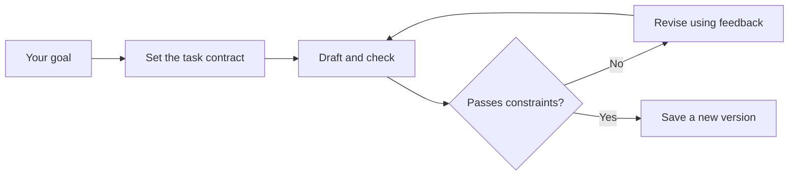

# Stage 1 — Demo Coach

Give an agent project notes. Get a checked, versioned pitch you can download.



## Run

Use Node.js 24 and a StepFun API key. From `voice-agent/01-basic-agent`:

```bash
npm ci
```

If neither this stage nor `voice-agent/.env` is configured, create a local file. Keep an existing configured `.env`:

```bash
cp .env.example .env
```

In `.env`, set:

```dotenv
STEP_API_KEY=YOUR_STEPFUN_API_KEY
```

On PowerShell, use `Copy-Item .env.example .env` instead of `cp`.

```bash
npm start
```

Open **<http://localhost:3200>**.

## Run a demo

Before running, **View input & prompt** shows the exact bundled text and task. You can copy it or choose **Edit in composer**. CampusMate is the sample project being pitched; no image is attached.

1. Click **Try CampusMate**. The brief is included.
2. Watch the agent set a goal, call tools, check its candidate and save a pitch.
3. Click **Make it 15 seconds**. It reads the saved work, checks the revision and saves a new version.
4. Download the Markdown or JSON. Use the version selector to revisit earlier work.

For a visible feedback loop, click **Repair a rough draft**. It supplies a real draft that exceeds a 15-second budget. The agent checks the original, gets the length failure, revises and rechecks before saving. Ordinary demo drafts may pass on their first check.

The activity panel shows real tool results. A passing check covers length and narrow wording rules; review factual claims against the brief. Duration is estimated.

## Want to explore?

- [How it works, why this SDK/Node.js, and troubleshooting](docs/GUIDE.md)
- Terminal option: `npm run chat`, then `/demo`.
- Offline checks: `npm run check` and `npm test`.
- Next: [Stage 2 — produce the pitch](../02-multimodal-agent/README.md).

Runtime: **Step 5 Preview + Vercel AI SDK**. Stage 1 needs no audio or search key.
