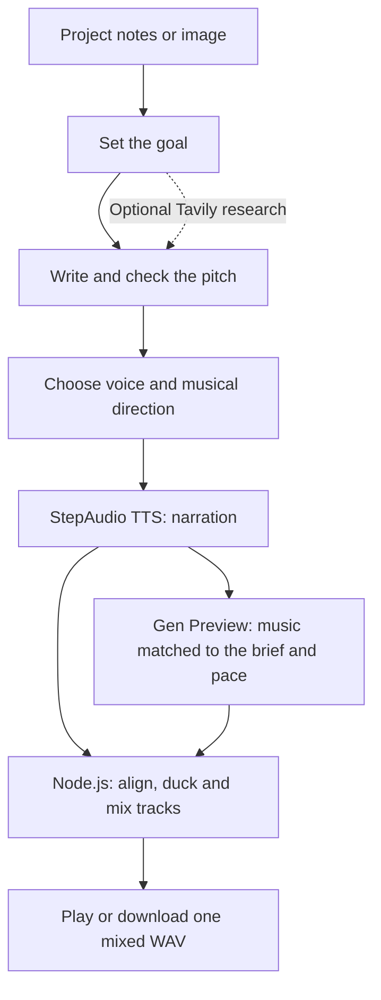

# Stage 2 — Frame & Voice

Upgrade the pitch agent: add images, optional research, and an audio introduction with narration and matching background music.



## Run

Use Node.js 24 and a StepFun key with **Step 5 Preview, StepAudio 3 TTS and Gen Preview** access. From `voice-agent/02-multimodal-agent`:

```bash
npm ci
```

If neither this stage nor `voice-agent/.env` is configured, create a local file. Keep an existing configured `.env`:

```bash
cp .env.example .env
```

In `.env`, set:

```dotenv
STEP_API_KEY=YOUR_STEPFUN_API_KEY
```

On PowerShell, use `Copy-Item .env.example .env` instead of `cp`.

```bash
npm start
```

Open **<http://localhost:3210>**.

## Run a demo

**Demo input & prompt** shows the exact bundled text and task, with copy/edit options. These two demos use text only; they describe sample projects rather than inspecting a real poster or screenshot.

1. Click **Produce CampusMate** or **Produce LaunchLens**. No recording or brief-writing is needed.
2. Follow **Agent activity**: goal → checked pitch → narration → matching music → mix.
3. Play the mixed WAV. Open **Listen to individual tracks** to compare the voice and music.
4. Ask: **Make it shorter and warmer, with quieter music.** Compare the saved versions.

**Try the LA Hacks poster** prepares an image-based draft. Press Send, inspect it, then select **Produce audio**. To continue from Stage 1, paste its spoken paragraph and ask to keep the words unchanged while producing audio.

The main WAV already contains overlapping voice and music. Musical quality needs listening; ask for a different palette if it clashes. Search is optional: add `TAVILY_API_KEY` to `.env` and restart when you are ready.

## Want to explore?

- [Audio pipeline, configuration, storage and troubleshooting](docs/GUIDE.md)
- [Ideas for your next agent upgrade](EXTENSIONS.md)
- Offline checks: `npm run check` and `npm test`.
- Full live demo check: `npm run smoke:production` (uses provider credits).

Runtime reasoning and vision: **Step 5 Preview + Vercel AI SDK**. Audio: **StepAudio 3 TTS + Gen Preview**, mixed in Node.js.
